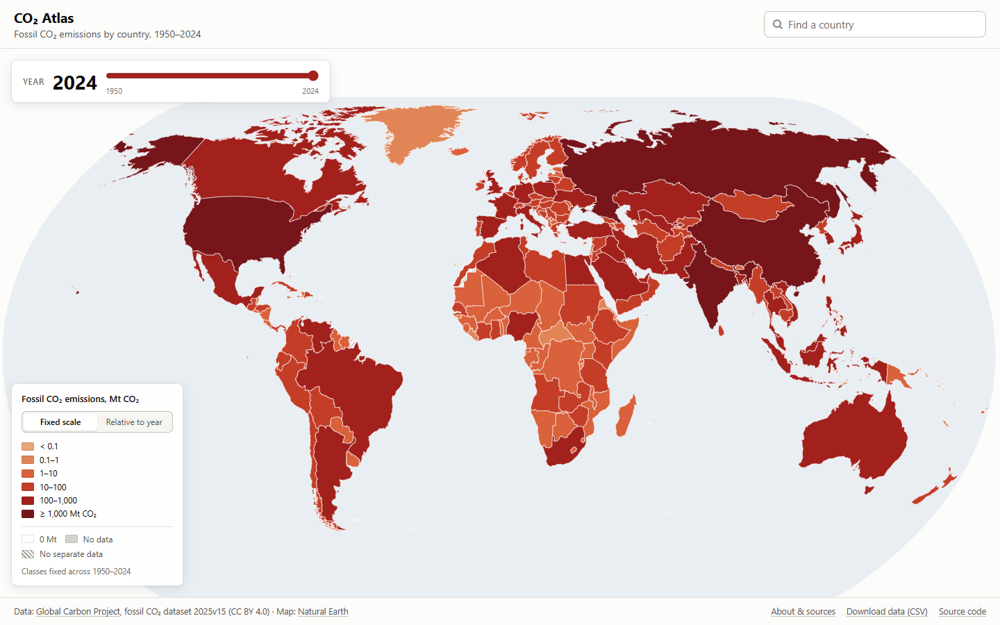
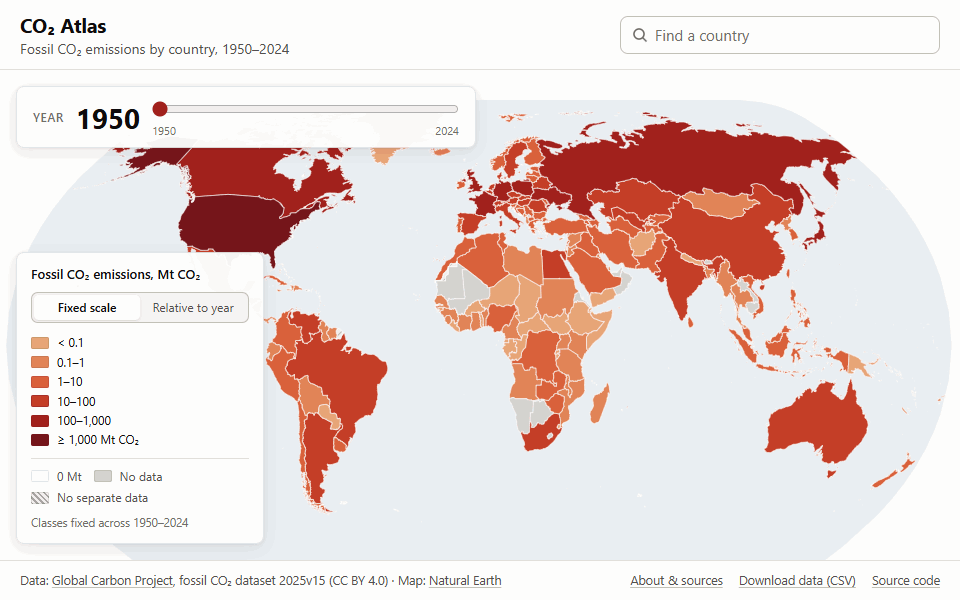
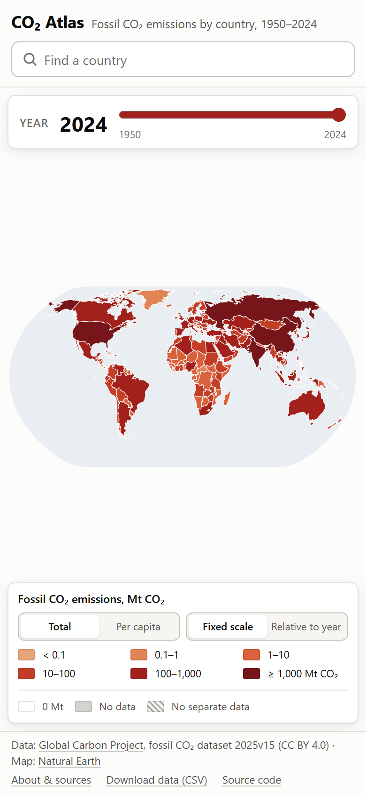
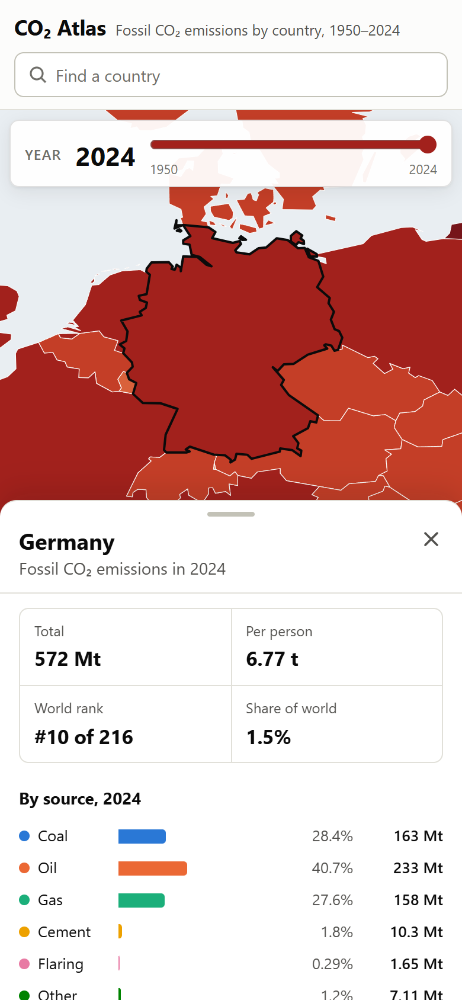
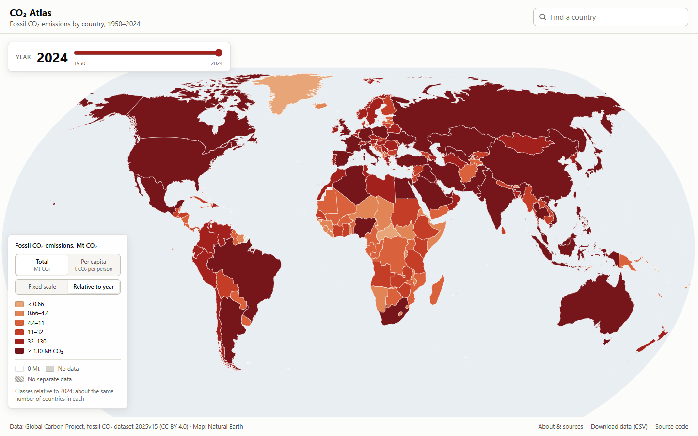
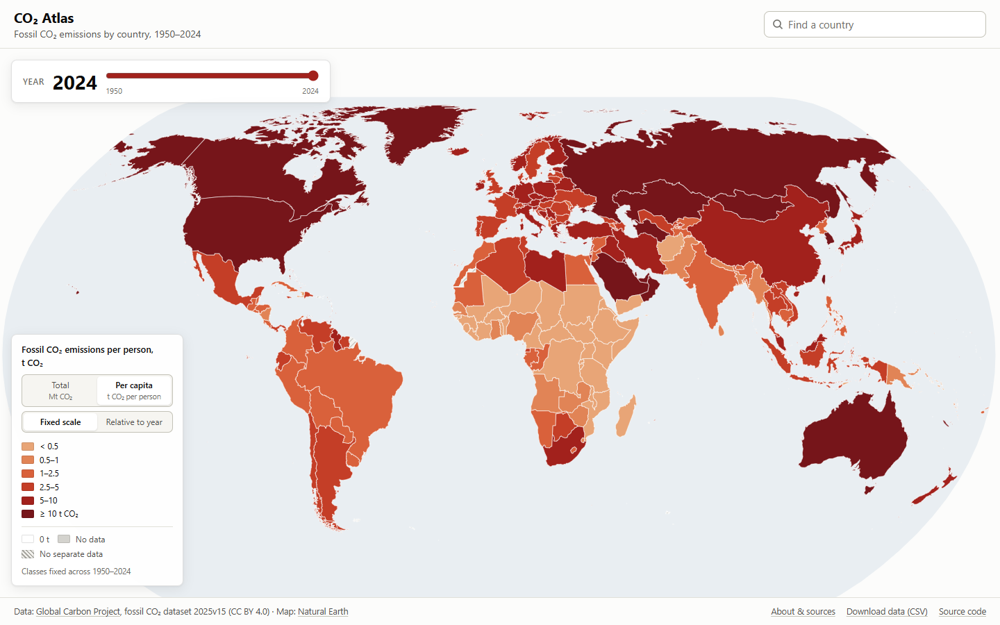
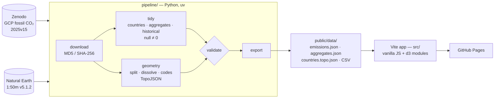

# CO₂ Atlas

An interactive map of fossil CO₂ emissions for every country from 1950 to 2024. It
is built with D3 on top of a reproducible pipeline that turns Global Carbon Project
data into small static files.

**Live:** https://kiko4902.github.io/co2-atlas/





## Features

- **Choropleth map, 1950–2024.**
  - Six logarithmic classes.
  - A year slider that recolours the map instantly. Paths are drawn once; only the
    fills change.
  - Separate legend entries for *0 Mt*, *No data* and *No separate data*.
- **Two metrics.** *Total* (Mt CO₂) or *Per capita* (t CO₂ per person). Switching
  only fades the fills; the paths are not redrawn. A country with emissions but no
  population series shows *No data* per person, not 0.
- **Two colour scales**, for both metrics.
  - *Fixed scale* (default): one set of classes for the whole period.
  - *Relative to year*: equal-count classes for the selected year.

  The legend, its caption, the tooltips and the map's screen-reader labels follow
  the active metric. The legend is generated from the same scale object the map
  uses, so it can never disagree with the map.
- **Country panel**, showing:
  - total emissions and emissions per person, with the metric shown on the map
    highlighted;
  - the world rank for the active metric, plus the share of world emissions (total)
    or the world average per person (per capita);
  - the split by coal, oil, gas, cement, flaring and other, as bars with
    percentages (sources with no estimate show *n/a*, not 0);
  - a stacked-area chart of sources over time with the total on top, a crosshair
    and a marker for the selected year.
- **Smart zoom.** Fits the country's main landmass, without far-away territories,
  into the part of the map not covered by the panel.
- **Accessible.**
  - The slider uses real years and `aria-valuetext`.
  - Countries can be focused with Tab, Enter opens the panel and Escape closes it.
  - Combobox search with accent-insensitive matching.
  - Visible focus rings, tap tooltips on touch screens and `prefers-reduced-motion`
    support.
- **Mobile.** On phones the panel becomes a bottom sheet that can be expanded,
  with the map above it.
- **Shareable links.** Year, country, metric and scale live in the URL; Back and
  Forward open and close countries, and the panel has a *Copy link* button.
- **Open data.** A tidy CSV of the full 1750–2024 history can be downloaded from
  the app.

<p>
  
  
</p>

## How to read the map

| Mode | Total | Per capita | Use it to |
|---|---|---|---|
| **Fixed scale** | `< 0.1`, `0.1–1`, `1–10`, `10–100`, `100–1,000`, `≥ 1,000` Mt CO₂ | `< 0.5`, `0.5–1`, `1–2.5`, `2.5–5`, `5–10`, `≥ 10` t CO₂ per person | Compare years: a colour always means the same amount |
| **Relative to year** | Quantile boundaries of the selected year (about ⅙ of countries per class) | The same, from the per-capita values | Compare countries within one year: the same colour means different amounts in different years |

- The per-capita classes come from the 1950–2024 distribution of country values. The
  top class is open-ended: places with very small populations and large refineries
  or oil and gas production (Sint Maarten reached 790 t in the 1950s, Qatar 120 t in the 1960s)
  would otherwise stretch the scale.

- **0 Mt** is a reported zero.
- **No data** means the dataset has no estimate for that year.
- **No separate data** (hatched) means the territory is not reported on its own
  (see below).
- *Share of world* uses the global total, which includes international aviation and
  shipping. Those are not assigned to any country, so country shares add up to less
  than 100%.





## Shareable links

The view is stored in the query string, so any state can be bookmarked or shared:

https://kiko4902.github.io/co2-atlas/?country=HRV&year=1990&metric=percapita

| Parameter | Values | Default (left out of the URL) |
|---|---|---|
| `country` | ISO 3166-1 alpha-3 code, e.g. `HRV`, `DEU`, `KSV` | none (no panel) |
| `year` | 1950–2024 | 2024 |
| `metric` | `total`, `percapita` | `total` |
| `scale` | `fixed`, `relative` | `fixed` |

- Moving the slider or switching the metric or scale updates the URL in place.
- Opening or closing a country adds a history entry, so Back closes the panel.
- Unknown or invalid values are ignored and the defaults are used instead.

## Architecture



- **`pipeline/`** (Python 3.13, uv, pandas, shapely, topojson, pytest, ruff).
  - Downloads and verifies the sources, cleans them and applies the territory rules
    declared in `config.toml`.
  - Validates the CSV-to-map join. The build fails on any unmatched country that is
    not a documented exception.
  - Writes compact columnar JSON.
  - Details and the data schema are in [`pipeline/README.md`](pipeline/README.md).
- **`src/`**: ES modules with JSDoc types checked by `tsc`.
  - `data` loads the files and gives O(1) access by year and by country.
  - `state` is a tiny store that tells views which keys changed.
  - `url-state` parses and writes the query string and keeps the browser history
    in sync with the store.
  - `scales` computes the colour scale as f(metric, mode, year).
  - `map`, `legend`, `panel`, `charts/*`, `tooltip`, `search`, `format` and `a11y`
    handle the views and helpers.
- **Data size:** 1.08 MB raw / 357 KB gzip, down from 18.9 MB in the original
  project. JS is 43 KB gzip.

## Running it

Requirements: Node 24 (`.nvmrc`), and Python ≥ 3.12 with
[uv](https://docs.astral.sh/uv/) for the pipeline.

```bash
npm ci
npm run dev            # http://localhost:5173/co2-atlas/
npm run build && npm run preview
```

Rebuild the data (the generated files are committed, so this is only needed for a
new release):

```bash
cd pipeline
uv sync
uv run co2-pipeline build
```

To move to a newer Global Carbon Project release, change `gcp.zenodo_record_id` in
`pipeline/config.toml` and rebuild. You can also run the **Update data** workflow,
which does this and opens a pull request.

## Tests and quality checks

```bash
npm run check                 # eslint, prettier, tsc (JSDoc), vitest
npm run test:e2e              # Playwright against the production build
PW_CHANNEL=msedge npm run test:e2e   # use an installed Edge/Chrome instead of downloading Chromium
npm run verify                # measurements, screenshots, demo GIF -> docs/
cd pipeline && uv run pytest && uv run ruff check . && uv run ruff format --check .
```

| Suite | What it covers |
|---|---|
| **pytest** (pipeline) | Aggregates vs countries, null vs 0, historical entities, per-capita source, split/dissolve/override rules, unmatched and stale exceptions, duplicate codes, polygon winding, checksums |
| **Vitest** | Both scale modes for both metrics, formatting, rank, share and world average, URL parsing and writing (including invalid input) and history sync, dataset access, zoom maths, search, store, and checks on the published files (winding, territory rules, values, per-capita outliers) |
| **Playwright** | No console errors or 404s; clicks on Serbia, Kosovo, Australia, France, French Guiana, Somalia, Cyprus, Western Sahara, China and Croatia checked against the CSV; slider, scale and metric switches, restoring a shared link, invalid links, Back/Forward, Copy link, keyboard flow, search and the touch bottom sheet |

CI runs all of them on every push and pull request. The deploy workflow publishes
`main` to GitHub Pages.

## Data sources and citations

- **Emissions:** Andrew, R. M. and Peters, G. P.: *The Global Carbon Project's
  fossil CO₂ emissions dataset*, version 2025v15, Zenodo,
  https://doi.org/10.5281/zenodo.17417124, 2025. Licensed under
  [CC BY 4.0](https://creativecommons.org/licenses/by/4.0/).
- **Global Carbon Budget:** Friedlingstein, P. et al.: *Global Carbon Budget 2025*,
  Earth Syst. Sci. Data, 18, 3211–3288,
  https://doi.org/10.5194/essd-18-3211-2026, 2026.
- **Boundaries:** [Natural Earth](https://www.naturalearthdata.com/) 1:50m admin-0
  countries and map units, v5.1.2 (public domain).

Per-person values use the population series published with the GCP dataset (UN
World Population Prospects).

## Territories

The map shows what the Global Carbon Project reports separately:

- **Own series, own polygon:** Kosovo, Greenland, the Caribbean Netherlands and
  Christmas Island have their own series and their own colour.
- **Counted in another country:** these are drawn hatched as *no separate data*,
  and the tooltip names the country:
  - French overseas regions (French Guiana, Guadeloupe, Martinique, Réunion,
    Mayotte) and Monaco → France;
  - Western Sahara → Morocco;
  - Vatican → Italy.
- **No series and no documented parent:** a few small territories (e.g. Puerto
  Rico, Jersey, the Falkland Islands) are shown as *no separate data*, without a
  claim about where their emissions are counted.
- **Merged:** Somaliland is shown as part of Somalia and Northern Cyprus as part of
  Cyprus.
- **Not drawn:** Antarctica. It can still be found through the search.

Borders are drawn for data display and do not imply any position on disputed
territories.

## Background

Originally built as a university project (FERIT Osijek, 2025), then rebuilt and
extended. The original repository is
[kiko4902/Vizualizacija-Podataka---Projektni-zadatak](https://github.com/kiko4902/Vizualizacija-Podataka---Projektni-zadatak).

## License

Code: [MIT](LICENSE). Data: CC BY 4.0 (Global Carbon Project), Natural Earth (public
domain).
